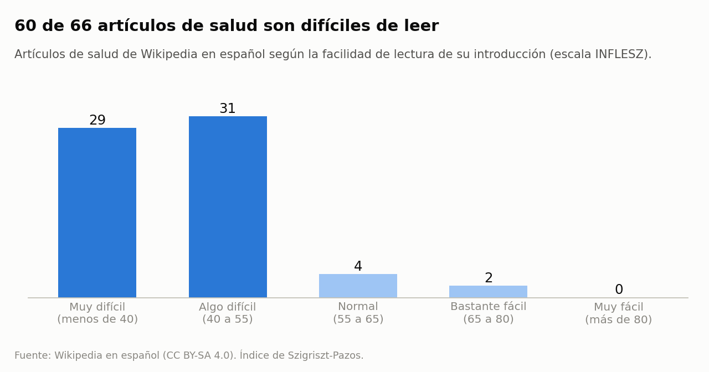

# Lectura fácil en salud

**¿Qué tan difícil de leer es la información de salud en español?**
Un medidor de facilidad de lectura y su aplicación a 66 artículos de salud de Wikipedia.

> **English summary.** A dependency-free Spanish readability scorer (Szigriszt-Pazos index with the INFLESZ scale, including a rule-based Spanish syllable counter) applied to the opening section of 66 Spanish Wikipedia health articles. 60 of 66 score below the "normal" level recommended for the general public. The project also documents a data-cleaning bug: invisible zero-width characters left by footnotes were merging sentences and overstating difficulty.

## Hallazgos

**1. 60 de 66 artículos de salud son difíciles de leer.** 29 son "muy difíciles" y 31 "algo difíciles" según la escala INFLESZ, creada para textos que leen pacientes. Solo 6 alcanzan el nivel "normal" o más fácil.



**2. El problema son las oraciones largas y las palabras largas.** La introducción típica tiene oraciones de 25 palabras y palabras de 2.2 sílabas. Su puntaje típico es 42 de 100; el nivel "normal" empieza en 55.

**3. Temas muy comunes están entre los más difíciles:** diabetes (25), accidente cerebrovascular (25), antibióticos (25). Los más fáciles: bronquitis (69) y sobrepeso (67).

**4. Reescribir cambia mucho.** El mismo contenido sobre el dengue:

| Versión | Texto | Puntaje |
|---|---|---:|
| Original | "El dengue es una enfermedad infecciosa viral transmitida por mosquitos del género Aedes, principalmente por el Aedes aegypti, y causada por el virus del dengue (DENV), perteneciente al género Flavivirus. La infección puede ser asintomática o manifestarse con fiebre alta, dolor de cabeza, dolores musculares y articulares intensos, y erupción cutánea." | 31, muy difícil |
| Lenguaje claro | "El dengue es una enfermedad causada por un virus. Se transmite por la picadura de un mosquito. Algunas personas no tienen molestias. Otras tienen fiebre alta, dolor de cabeza, dolor en los músculos y ronchas en la piel." | 81, muy fácil |

## Úsalo con tus propios textos

```bash
pip install -r requirements.txt
python -m lectura "El dengue es una enfermedad. La transmite un mosquito. Da fiebre y dolor."
```

```
Facilidad de lectura: 87.5 de 100 (Muy fácil)
Palabras por oración: 4.3   Sílabas por palabra: 1.85
```

Sirve para revisar folletos, avisos, publicaciones en redes o textos de campañas antes de publicarlos.

## Un error que casi se publica

La primera corrida decía que 51 artículos eran "muy difíciles" y que uno tenía oraciones de 487 palabras. La causa: Wikipedia deja un carácter invisible (espacio de ancho cero) donde iba cada nota al pie. Un punto seguido de ese carácter no va seguido de un espacio, así que párrafos enteros se leían como una sola oración. Al limpiar esos caracteres, los "muy difíciles" bajaron de 51 a 29. La corrección tiene su propia prueba en [`tests/`](tests/test_readability.py).

## Método

- **Índice de Szigriszt-Pazos** (1993), adaptación al español de la fórmula de Flesch: `206.835 − 62.3 × (sílabas ÷ palabras) − (palabras ÷ oraciones)`. Más alto es más fácil.
- **Escala INFLESZ** (Barrio-Cantalejo y colaboradores, 2008): muy difícil (menos de 40), algo difícil (40 a 55), normal (55 a 65), bastante fácil (65 a 80), muy fácil (más de 80).
- **Sílabas:** contador propio con las reglas de diptongo e hiato del español, probado con 22 palabras.
- **Textos:** la introducción de cada artículo, que es lo que lee la mayoría y lo que citan buscadores y asistentes. Se descartan introducciones de menos de 40 palabras.

## Limitaciones

- **La fórmula mide forma, no comprensión.** No sabe si un término técnico está explicado ni si el texto está bien organizado.
- **Solo la introducción** de 66 temas elegidos a mano ([lista](lectura/data.py)); no representa toda la Wikipedia ni otras fuentes de salud.
- **Introducciones cortas** (una sola oración) dan puntajes inestables.
- **El contador de sílabas** tiene casos límite conocidos, como la "h" entre vocales.
- Wikipedia cambia: los textos son los descargados en noviembre de 2026.

## Reproducirlo

```bash
python -m lectura
python -m pytest
```

Los textos ya vienen en `data/intros.csv`. Para descargarlos de nuevo: `python -m lectura.data`.

## Fuente y licencia

Textos: Wikipedia en español, licencia CC BY-SA 4.0. Código bajo licencia MIT.
